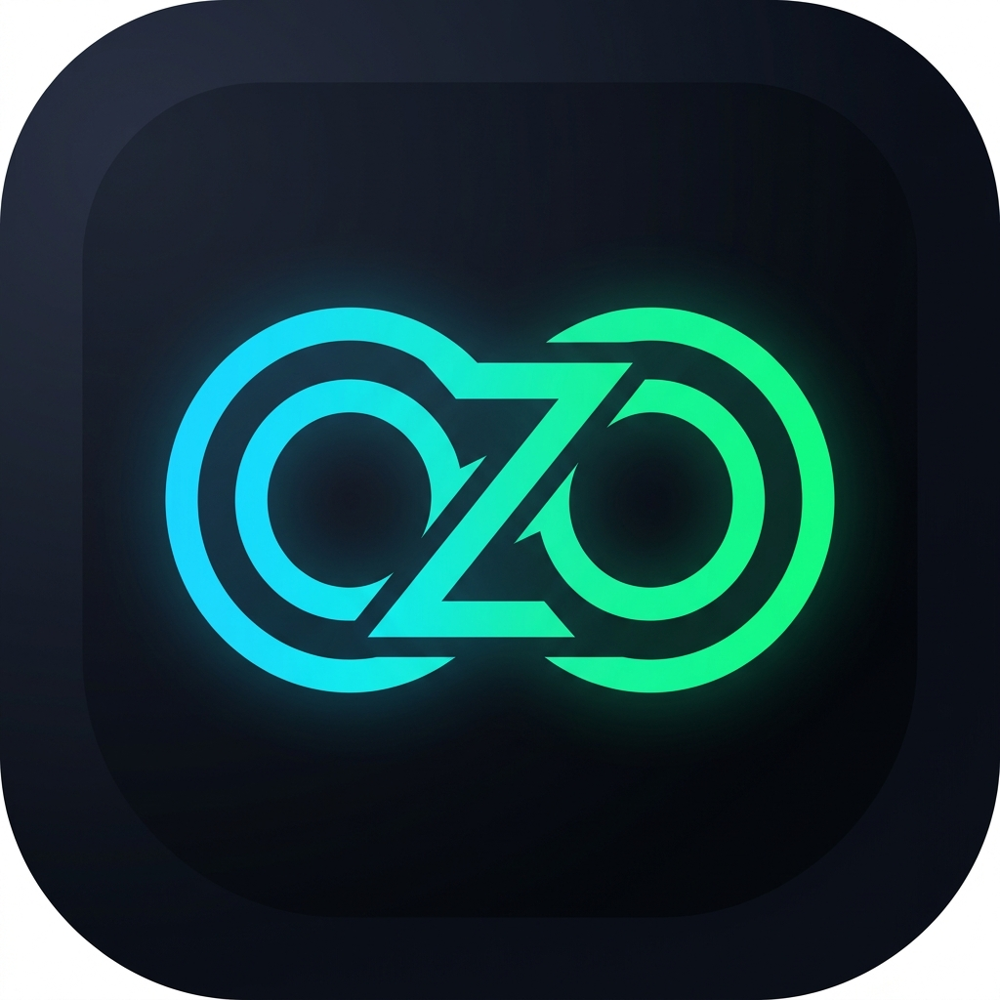
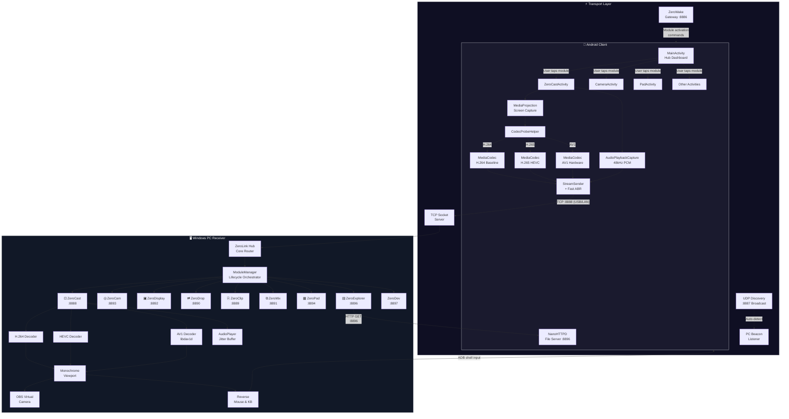

<div align="center">



# ZeroLink

### **Modular Cross-Device Ecosystem Hub • Windows PC & Android**

*Next-Gen Video Codecs (H.264 • H.265/HEVC • AV1) • Studio Internal Audio • Virtual Camera • Multi-Module Pluggable Suite*

<p align="center">
  
  
  
  
</p>

</div>

---

## 📖 Introduction

**ZeroLink** is a high-performance, modular cross-device ecosystem connecting Windows PCs and Android devices over USB or LAN. Designed with a **Clean Minimalist Monochrome** aesthetic (Pure Black `#111827` & Pure White `#FFFFFF`) and an **Extensible Pluggable Architecture**, ZeroLink functions as a centralized command hub where features exist as independent, lightweight modules that can be activated on demand.

When a module is inactive, its network sockets, audio sinks, and background listeners remain completely dormant—ensuring zero unnecessary CPU/RAM overhead and absolute battery efficiency. Multiple modules can run **simultaneously** — you can mirror your screen, transfer files, and use the trackpad all at the same time.

---

## 🧩 The ZeroLink Module Suite (9 Modules)

```
  ┌────────────────────────────────────────────────────────────────┐
  │                      ZeroLink Core Hub                         │
  │   (ZeroWake Gateway • LAN Discovery • Session Sync • ADB)     │
  └───────┬──────────┬──────────┬──────────┬──────────┬───────────┘
          │          │          │          │          │
  ┌───────┴───┐ ┌────┴────┐ ┌──┴───┐ ┌────┴────┐ ┌──┴──────┐
  │ ⊡ ZeroCast│ │◎ ZeroCam│ │▣ Zero│ │⧉ ZeroMix│ │⎘ Zero   │
  │ Screen &  │ │ Wireless│ │ Disp │ │ Audio   │ │ Clip    │
  │ Audio     │ │ Webcam  │ │ 2nd  │ │ Mixer & │ │ Shared  │
  │ Mirror    │ │ OBS     │ │ Mon  │ │ FX      │ │ Clipbrd │
  └───────────┘ └─────────┘ └──────┘ └─────────┘ └─────────┘
          │          │          │
  ┌───────┴───┐ ┌────┴────┐ ┌──┴──────┐
  │⇄ ZeroDrop │ │▦ ZeroPad│ │▤ Zero   │
  │ File      │ │ Remote  │ │ Explorer│
  │ Transfer  │ │ Control │ │ Gallery │
  └───────────┘ └─────────┘ └─────────┘
                     │
              ┌──────┴──────┐
              │</> ZeroDev  │
              │ Dev Console │
              └─────────────┘
```

---

### ⊡ 1. ZeroCast — *Ultra-Low Latency Screen & Audio Mirroring*

| Feature | Detail |
| :--- | :--- |
| **Multi-Codec Video** | H.264 (AVC Baseline) · H.265 (HEVC Main, 50% bandwidth savings) · AV1 (libdav1d SIMD) |
| **Internal Audio** | `AudioPlaybackCapture` streams game & system audio in 16-bit 48 kHz Stereo PCM |
| **Audio Sink Routing** | Instant switch between Headphones, Speakers, Gaming Headset, and External Monitor audio output |
| **Virtual Camera** | Feed screen or camera into `OBS Virtual Camera` for Discord, Zoom, Meet, and OBS Studio |
| **Reverse Control** | Click, drag, swipe your phone from PC; type with your physical keyboard directly into Android |
| **OLED Auto-Dim** | Lowers phone backlight to 1% while casting — reduces heat, saves battery |
| **Screen Recording** | Record the mirrored stream locally on PC |

### ◎ 2. ZeroCam — *Wireless Mobile Webcam*

Turn your smartphone into a crystal-clear **1080p 60 FPS** wireless webcam. Supports front/rear camera toggle, torch/flash control, auto-focus lock, and direct OBS Virtual Camera output.

### ▣ 3. ZeroDisplay — *Wireless Secondary Monitor*

Extend your Windows desktop onto your Android tablet or phone as a genuine second monitor. Configurable FPS and quality sliders with multi-monitor selection.

### ⇄ 4. ZeroDrop — *Peer-to-Peer File Transfer*

High-speed direct LAN/USB file and folder sharing between Windows and Android with zero cloud reliance. Features drag-and-drop zone, progress bars, and Windows context menu integration ("Send via ZeroDrop").

### ⎘ 5. ZeroClip — *Shared Clipboard*

Instant **bidirectional** clipboard sync: copy text on PC → paste on Android, and vice-versa. Includes clipboard history with clickable cards.

### ⧉ 6. ZeroMix — *Virtual Audio Mixer & Voice FX Studio*

Route, mix, and apply real-time studio effects to your mobile microphone and phone audio. Includes a full DSP chain:
- **Noise Gate** — Silence background noise below threshold
- **High-Pass Filter** — Remove rumble and low-frequency hum
- **Compressor** — Even out volume dynamics for broadcast-quality audio
- **De-Esser** — Tame harsh sibilance ("S" / "Sh" sounds)
- **Voice FX** — Pitch shifting and audio effects
- **VU Meters** — Real-time visual level monitoring
- **Auto-Duck** — Smart auto-ducking between phone audio and mic

### ▦ 7. ZeroPad — *Remote Trackpad & Macro Controller*

Turn your phone into a precision trackpad with multi-touch gestures, presentation remote clicker, gyroscope air mouse, and customizable macro key grid. Acts as a mobile **Stream Deck**.

### ▤ 8. ZeroExplorer — *Phone Gallery, Storage Explorer & Media Streamer*

Browse your phone's entire file system, gallery, and media library from the PC. Features:
- **Pro Image Viewer** with zoom & pan
- **Full Video Player** with timeline scrubbing and frame snapping
- **Category Badges** and instant file filtering
- **Download Manager** with itemized progress queue, live speed, and ETA
- **Batch Download** for bulk media transfer

### </> 9. ZeroDev — *Developer Console & Module Workshop*

Network diagnostic probe console, live port scanner, ADB device manager, and automatic module scaffolding tool for generating new PC + Android module boilerplate.

---

## 🏗️ Architecture Overview

### System Topology



### Network Port Map

| Port | Service | Protocol | Direction | Description |
| :---: | :--- | :---: | :---: | :--- |
| `8886` | **ZeroWake** Master Gateway | TCP | Phone → PC | Remote module wake/sleep commands |
| `8887` | **LAN Discovery** Beacon | UDP | Broadcast | Auto-detect PC on local network |
| `8888` | **ZeroCast** Screen & Audio | TCP | Phone → PC | H.264/HEVC/AV1 video + PCM audio |
| `8889` | **ZeroClip** Clipboard Sync | TCP | Bidirectional | Text clipboard synchronization |
| `8890` | **ZeroDrop** File Transfer | TCP | Bidirectional | Peer-to-peer file/folder sharing |
| `8891` | **ZeroMix** Audio Mixer | WebSocket | Phone → PC | Microphone audio stream + FX |
| `8892` | **ZeroDisplay** Extended Monitor | TCP | PC → Phone | PC screen capture → phone display |
| `8893` | **ZeroCam** Virtual Webcam | TCP | Phone → PC | Camera feed → OBS Virtual Camera |
| `8894` | **ZeroPad** Remote Control | TCP | Phone → PC | Mouse, keyboard, gesture, macro input |
| `8895` | **SpeedTest** Diagnostics | TCP | Internal | Bandwidth/latency measurement |
| `8896` | **ZeroExplorer** File Browser | HTTP | PC → Phone | REST API for gallery & storage browsing |
| `8897` | **ZeroDev** Developer Console | TCP | Diagnostic | Port scanner & network diagnostics |

### Binary Protocol

All real-time streams use a custom **16-byte binary framing header** over raw TCP sockets:

```
┌──────────┬──────────┬──────────┬──────────┬──────────────────┬──────────────────────────┐
│ Magic    │ Type     │ Flags    │ Reserved │ Payload Length   │ Timestamp                │
│ 0xAA     │ 1 byte   │ 1 byte   │ 1 byte   │ 4 bytes (LE)     │ 8 bytes (LE, µs)         │
│ (1 byte) │          │          │          │                  │                          │
└──────────┴──────────┴──────────┴──────────┴──────────────────┴──────────────────────────┘
```

| Type Byte | Content | Flags |
| :---: | :--- | :--- |
| `0x01` | MJPEG Frame | `0x01` Keyframe |
| `0x02` | H.264 NAL Unit | `0x02` Codec Config (SPS/PPS) |
| `0x03` | PCM Audio Chunk | `0x04` Landscape Orientation |
| `0x04` | Config JSON | |
| `0x05` | Input Control Event | |
| `0x06` | HEVC NAL Unit | |
| `0x07` | AV1 OBU | |

### Connection Modes

```
┌─────────────────────────────────────────────────────────┐
│                   CONNECTION MODES                       │
├─────────────────────────┬───────────────────────────────┤
│   🔌 USB (Lowest Latency)   │   📶 Wi-Fi LAN              │
├─────────────────────────┼───────────────────────────────┤
│ Phone ──USB──► PC        │ Phone ──Wi-Fi──► Router       │
│                          │ PC ────Wi-Fi──► Router        │
│ ADB reverse tunneling   │                               │
│ auto-configures ports    │ UDP beacon auto-discovers     │
│                          │ PC IP on the LAN              │
│ Best for: gaming,        │ Best for: convenience,        │
│ low-latency casting      │ wireless freedom              │
└─────────────────────────┴───────────────────────────────┘
```

---

## 🔧 Technology Stack

### 🖥️ PC Receiver (Windows)

| Layer | Technology |
| :--- | :--- |
| **Language** | Python 3.10+ |
| **UI Framework** | PyQt6 (Fusion style, custom monochrome theme) |
| **Video Decoding** | PyAV (FFmpeg C-bindings) for H.264/HEVC; libdav1d for AV1 |
| **Audio Playback** | `sounddevice` (PortAudio) + `QAudioSink` with jitter buffer |
| **Virtual Camera** | `pyvirtualcam` → OBS Virtual Camera driver |
| **Screen Capture** | `mss` (for ZeroDisplay module) |
| **Input Injection** | `pyautogui` + `pywin32` Win32 API + ADB shell input |
| **Image Processing** | Pillow, OpenCV |
| **Auto-Update** | GitHub Releases polling via `updater.py` |
| **Build/Package** | PyInstaller (standalone `.exe`) |

### 📱 Android Client

| Layer | Technology |
| :--- | :--- |
| **Language** | Kotlin (JVM 17) |
| **Target SDK** | Android API 35 (compileSdk 35, minSdk 29) |
| **Screen Capture** | `MediaProjection` API |
| **Video Encoding** | `MediaCodec` hardware encoder (H.264 / HEVC / AV1) |
| **Audio Capture** | `AudioPlaybackCapture` (48 kHz, 16-bit PCM) |
| **Camera** | CameraX 1.4.1 |
| **Networking** | Kotlin Coroutines 1.10.1 + raw TCP sockets |
| **UI** | Material Design 3 + ViewBinding |
| **File Server** | Custom HTTP server (NanoHTTPD-style) for ZeroExplorer |
| **Auto-Update** | GitHub Releases polling via `UpdateChecker` |
| **Build** | Gradle (Kotlin DSL) |

---

## 📂 Project Structure

```
ZeroLink/
├── README.md                         # ← You are here
├── LICENSE                           # MIT License
├── assets/                           # Brand assets & logos
│   ├── logo.png                      # Primary 512×512 monochrome logo
│   ├── logo_monogram.png             # Z monogram mark
│   └── zerolink_logo.png             # Full wordmark
│
├── pc_receiver/                      # 🖥️ Windows PC Application
│   ├── main.py                       # Entry point (--minimized, --tray, --send)
│   ├── requirements.txt              # Python dependencies
│   ├── ZeroLink.spec                 # PyInstaller build spec
│   ├── icon.ico / icon.png           # Window & taskbar icons
│   │
│   ├── core/                         # ── Hub Engine ──
│   │   ├── base_module.py            # Abstract BaseModule interface
│   │   ├── module_manager.py         # Pluggable lifecycle registry & orchestrator
│   │   ├── protocol.py              # 16-byte binary framing header
│   │   ├── server.py                 # TCP server & stream dispatcher
│   │   ├── h264_decoder.py           # PyAV H.264 zero-latency decoder
│   │   ├── hevc_decoder.py           # PyAV H.265 low-delay SIMD decoder
│   │   ├── av1_decoder.py            # libdav1d AV1 high-performance decoder
│   │   ├── audio_player.py           # Jitter-buffered QAudioSink with device routing
│   │   ├── audio_mixer.py            # Virtual audio routing & voice FX matrix
│   │   ├── mic_dsp.py                # Studio mic DSP chain (gate, comp, de-ess, HPF)
│   │   ├── voice_fx.py               # Voice effects processor
│   │   ├── virtual_cam.py            # pyvirtualcam OBS integration
│   │   ├── input_controller.py       # Reverse mouse & keyboard ADB injector
│   │   ├── adb_helper.py             # ADB detection & port reverse tunneling
│   │   ├── discovery.py              # UDP broadcast beacon for LAN auto-discovery
│   │   ├── display_server.py         # Screen capture & streaming to phone
│   │   ├── cam_server.py             # Camera stream receiver
│   │   ├── pad_server.py             # Remote control input receiver
│   │   ├── clipboard_service.py      # Bidirectional clipboard sync
│   │   ├── file_transfer.py          # File transfer service
│   │   ├── zeromix_service.py        # Audio mixer network service
│   │   ├── speedtest_server.py       # Bandwidth & latency diagnostics
│   │   ├── telemetry.py              # Smoothed FPS, bitrate & latency tracker
│   │   └── updater.py                # GitHub Releases auto-update engine
│   │
│   ├── modules/                      # ── Pluggable Modules ──
│   │   ├── zerocast/                 # ⊡ Screen & audio mirroring (1556 LOC)
│   │   │   ├── cast_module.py
│   │   │   └── manifest.py
│   │   ├── zerocam/                  # ◎ Wireless webcam
│   │   │   ├── cam_module.py
│   │   │   └── manifest.py
│   │   ├── zerodisplay/              # ▣ Extended monitor
│   │   │   ├── display_module.py
│   │   │   └── manifest.py
│   │   ├── zerodrop/                 # ⇄ File transfer
│   │   │   ├── drop_module.py
│   │   │   └── manifest.py
│   │   ├── zeroclip/                 # ⎘ Shared clipboard
│   │   │   ├── clip_module.py
│   │   │   └── manifest.py
│   │   ├── zeromix/                  # ⧉ Audio mixer & DSP studio
│   │   │   ├── mix_module.py
│   │   │   └── manifest.py
│   │   ├── zeropad/                  # ▦ Remote trackpad & macros
│   │   │   ├── pad_module.py
│   │   │   └── manifest.py
│   │   ├── zeroexplorer/             # ▤ Phone gallery & file manager (2411 LOC)
│   │   │   ├── explorer_module.py
│   │   │   ├── download_manager.py
│   │   │   └── manifest.py
│   │   └── zerodev/                  # </> Developer console
│   │       ├── dev_module.py
│   │       └── manifest.py
│   │
│   └── ui/                           # ── Monochrome UI Layer ──
│       ├── main_window.py            # Hub window & sidebar navigation
│       ├── dashboard_view.py         # Card-based module overview
│       ├── connections_view.py       # USB ADB, Wi-Fi LAN & speedtest UI
│       ├── speedtest_dialog.py       # Animated speedtest modal
│       ├── flow_layout.py            # Flow layout widget
│       └── theme.py                  # Minimal monochrome stylesheet & colors
│
├── android_client/                   # 📱 Android Application
│   ├── build.gradle.kts
│   └── app/
│       ├── build.gradle.kts          # compileSdk 35, minSdk 29, Kotlin JVM 17
│       └── src/main/
│           ├── AndroidManifest.xml
│           ├── java/com/zerocast/
│           │   ├── capture/
│           │   │   ├── ScreenCaptureH264Manager.kt    # MediaCodec H.264 encoder
│           │   │   ├── ScreenCaptureHevcManager.kt    # MediaCodec H.265 encoder
│           │   │   ├── AudioCaptureManager.kt         # AudioPlaybackCapture 48kHz
│           │   │   └── CameraCaptureManager.kt        # CameraX video feed
│           │   ├── network/
│           │   │   ├── StreamSender.kt                # Async socket transmitter + ABR
│           │   │   └── NetworkDiscovery.kt            # UDP LAN auto-discovery client
│           │   ├── protocol/
│           │   │   └── PacketHeader.kt                # 16-byte binary framing header
│           │   ├── service/
│           │   │   ├── StreamForegroundService.kt     # MediaProjection foreground service
│           │   │   └── FloatingOverlayService.kt      # Floating performance HUD
│           │   ├── speedtest/                         # Network speed diagnostics
│           │   ├── util/
│           │   │   ├── ZeroLinkConfig.kt              # Port constants & SharedPreferences
│           │   │   ├── CodecProbeHelper.kt            # Hardware codec capability prober
│           │   │   └── UpdateChecker.kt               # GitHub Releases auto-updater
│           │   └── ui/
│           │       ├── MainActivity.kt                # Hub dashboard & module launcher
│           │       └── ZeroCastActivity.kt            # Dedicated stream controller UI
│           └── res/                                   # Material 3 monochrome resources
│
└── dist/                             # 📦 Pre-compiled Release Binaries
    ├── ZeroLink.apk                  # Android installer
    └── ZeroLink-v1.0.0-Windows.zip   # Windows standalone package
```

---

## 🚀 Quick Start Guide

### Option 1: Using Pre-compiled Binaries (Recommended)

1. **Windows PC** — Download and extract `ZeroLink-v1.0.0-Windows.zip` from [`dist/`](dist/), then run **`ZeroLink.exe`**.
2. **Android** — Install `ZeroLink.apk` from [`dist/`](dist/) on your phone.
3. **Connect**:
   - **Via USB (Lowest Latency)**: Enable USB Debugging on your phone, plug it in, and ZeroLink will automatically configure ADB reverse tunneling.
   - **Via Wi-Fi LAN**: Connect both devices to the same Wi-Fi network; ZeroLink auto-discovers the PC via UDP beacon on port 8887.

### Option 2: Building from Source

#### 🖥️ PC Receiver

Requires **Python 3.10+** and **Windows 10/11 (64-bit)**:

```powershell
# Clone the repository
git clone https://github.com/WhyAlwaysEng/ZeroLink.git
cd ZeroLink/pc_receiver

# (Recommended) Create a virtual environment
python -m venv .venv
.\.venv\Scripts\Activate.ps1

# Install dependencies
pip install -r requirements.txt

# Run the ZeroLink Hub
python main.py
```

**Build standalone executable:**
```powershell
pyinstaller ZeroLink.spec --noconfirm
```

**Command-line flags:**
| Flag | Description |
| :--- | :--- |
| `--minimized` / `--tray` | Start minimized to system tray |
| `--send <path>` | Send a file via ZeroDrop (Windows context menu integration) |

#### 📱 Android Client

Requires **Android Studio** or **Android SDK (API 35)**:

```powershell
cd ZeroLink/android_client

# Build Debug APK
.\gradlew.bat assembleDebug

# Install to connected phone via ADB
adb install -r app/build/outputs/apk/debug/app-debug.apk
```

---

## 🎥 Using Virtual Camera in Discord / Zoom / Teams

1. Connect your Android phone and start streaming via **ZeroCast** or **ZeroCam**.
2. Click **`[ ⛶ V-Cam: OFF ]`** in the top ribbon → it will activate to **`[ ⛶ V-Cam: ON ]`**.
3. Open **Discord**, **Zoom**, or **Google Meet** → **Settings** → **Voice & Video** → **Camera** → Select **`OBS Virtual Camera`**.
4. Your Android camera or screen is now broadcasting as your high-definition 60 FPS webcam.

> **Note:** Requires [OBS Studio](https://obsproject.com/) installed to provide the Windows OBS Virtual Camera driver.

---

## ⌨️ PC Keyboard & Mouse Shortcuts

| Shortcut | Function |
| :--- | :--- |
| **Left Click & Drag** | Simulates touch tap and swipe on the Android device |
| **F11 / Double Click** | Toggle Fullscreen Mode |
| **Esc** | Exit Fullscreen / Send Android Back Key |
| **PC Typing** | Directly inputs text, letters, space, backspace, and enter to Android |
| **`⛶ V-Cam` Button** | Activates Virtual Camera feed for Discord, Zoom, OBS |
| **`📌 Pin` Button** | Pins the ZeroLink window always on top |

---

## 🔒 Mutual Exclusion & Safety

- **ZeroCast ↔ ZeroMix** are mutually exclusive: both use `AudioPlaybackCapture` on the phone, so only one can stream at a time. The UI enforces this — starting one will prompt you to stop the other.
- **All other modules** can run concurrently without restriction.

---

## 📋 Requirements

### PC (Windows)
- **OS**: Windows 10 / 11 (64-bit)
- **Python**: 3.10, 3.11, 3.12, or 3.13 (64-bit)
- **Virtual Camera** (Optional): [OBS Studio](https://obsproject.com/) installed

### Android
- **OS**: Android 10+ (API 29+)
- **Permissions**: Screen capture (MediaProjection), audio capture, camera, storage, overlay
- **USB Debugging** enabled (for USB connection mode)

### Python Dependencies (`requirements.txt`)
```
PyQt6>=6.6.0          # UI framework
Pillow>=10.0.0        # Image processing
qrcode>=7.4.0         # QR code generation for connection
pyautogui>=0.9.54     # Mouse/keyboard automation
av>=12.0.0            # FFmpeg video decoding (H.264, HEVC)
opencv-python>=4.8.0  # Image manipulation & virtual camera
pyvirtualcam>=0.15.0  # OBS Virtual Camera feed
sounddevice>=0.4.6    # Audio playback (PortAudio)
numpy>=1.24.0         # Numerical computing
pywin32>=306          # Windows API integration
mss>=10.0.0           # Screen capture (ZeroDisplay)
```

---

## 🏛️ Design Philosophy

### Clean Minimalist Monochrome

ZeroLink follows a **Swiss monochrome minimalism** design language across both PC and Android:

| Element | Value |
| :--- | :--- |
| **Primary Background** | `#111827` (Rich Black) |
| **Primary Text** | `#FFFFFF` (Pure White) |
| **Secondary/Borders** | `#374151` / `#4B5563` (Gray tones) |
| **Accent Hover** | `#E5E7EB` (Light Gray) |
| **Typography** | System sans-serif, clean spacing |
| **Icons** | Unicode geometric glyphs (⊡ ◎ ▣ ⇄ ⎘ ⧉ ▦ ▤ </>) |

No color gradients, no neon accents, no skeuomorphism. Every pixel serves a purpose.

### Pluggable Module Architecture

Every feature is a self-contained module implementing the `BaseModule` abstract interface:

```python
class BaseModule(ABC):
    module_id: str          # Unique identifier (e.g., "zerocast")
    display_name: str       # Human-readable name
    icon_glyph: str         # Unicode icon character
    description: str        # One-line description

    def start_service(self)   # Activate network listeners
    def stop_service(self)    # Tear down gracefully
    def get_widget(self)      # Return the PyQt6 widget
```

The `ModuleManager` handles registration, on-demand activation, and lifecycle coordination. Adding a new module requires only:
1. Create a new directory under `modules/`
2. Implement `BaseModule` in a `*_module.py` file
3. Register it in `main_window.py`

---

## 📝 Changelog

### v1.1.0 (Latest)
- ✅ **Multi-module concurrency** — modules no longer auto-kill when navigating away
- ✅ **ZeroExplorer** — full phone gallery, storage browser, video player, and download manager
- ✅ **ZeroDev** — developer console with port scanner and module scaffolder
- ✅ **Studio Mic DSP** — noise gate, high-pass filter, compressor, and de-esser for ZeroMix
- ✅ **ZeroWake Gateway** — remote module wake/sleep from phone (port 8886)
- ✅ **Smart Auto-Lifecycle** — auto-start module on phone connect, debounced disconnect handling
- ✅ **Screen Recording** — record ZeroCast mirror to local file
- ✅ **OLED Black Standby** — phone screen dims while casting
- ✅ **Gyro Air Mouse** — ZeroPad gyroscope-based cursor control
- ✅ **Mutual Exclusion** — ZeroCast ↔ ZeroMix streaming safety lock
- ✅ **ZeroExplorer Freeze Fix** — QPixmap thread-safety for large galleries
- ✅ **ZeroDrop Port Fix** — corrected port mismatch (8895 → 8890)
- ✅ **ZeroPad Drag Release** — proper mouse button release on module exit

### v1.0.0
- 🎉 Initial release with ZeroCast, ZeroCam, ZeroDisplay, ZeroDrop, ZeroClip, ZeroMix, ZeroPad
- Multi-codec video pipeline (H.264, H.265/HEVC, AV1)
- USB ADB reverse tunneling + Wi-Fi LAN auto-discovery
- OBS Virtual Camera integration
- Reverse mouse & keyboard control
- Studio audio engine with jitter buffer and device routing

---

## 📜 License

ZeroLink is open-source software licensed under the [MIT License](LICENSE).

---

<div align="center">

**Built with ❤️ for the modular cross-device future.**

*ZeroLink — Zero Latency. Zero Limits.*

</div>
