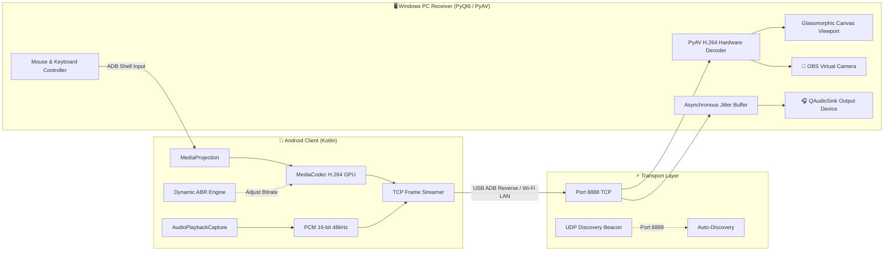

<div align="center">


# ZeroCast v1.0

### **Ultra-Low Latency Native Android Screen & Audio Mirroring Engine**
*High-Performance GPU H.264 Acceleration • Studio PCM Internal Audio • Virtual Camera (OBS/Discord) • Reverse Control*

[](https://github.com/WhyAlwaysEng/ZeroCast/releases)
[](https://github.com/WhyAlwaysEng/ZeroCast)
[](LICENSE)
[](https://python.org)
[](https://kotlinlang.org)

</div>

---

## 🌟 Highlights & Key Features

ZeroCast is an open-source, ultra-low latency screen mirroring and internal audio streaming ecosystem built specifically for gaming, content creation, presentations, and device management over local Wi-Fi or USB cable.

- ⚡ **Zero-Latency H.264 GPU Pipeline**: Hardware-accelerated encoding directly from Android `MediaCodec` into PyAV C-level decoding with baseline profile (no B-frames) for instantaneous responsiveness.
- 📱 **100% Native Display Resolution**: Supports high-density physical resolutions (e.g. 1080×2400 FHD+) with dynamic orientation auto-switching (Landscape ⇄ Portrait).
- 🔊 **Internal Audio Capture (`AudioPlaybackCapture`)**: Streams system audio and game audio directly into PC speakers with dedicated ~200ms Jitter Buffer and zero crackle.
- 🎧 **Dynamic Audio Output Selector**: Easily route mobile audio between your Gaming Headset (HyperX, etc.) and Speakers directly from the PC receiver.
- 🎥 **Virtual Camera Integration**: Turn your mobile device (screen or camera) into an ultra-sharp 1080p 60FPS webcam for **Discord, Zoom, Google Meet, Microsoft Teams, and OBS Studio**.
- 🖱️ **Full Reverse Touch & Keyboard Injection**: Click, drag, and swipe the phone from your PC screen with automatic ADB tunneling. Type directly using your physical PC keyboard.
- 📊 **Floating Mobile Performance HUD**: Drag-and-drop floating pill displaying live CPU %, RAM %, and Battery Temp on your phone, with tap-to-shrink Ghost Mode (completely invisible on PC).
- 🌙 **Auto-Dim Screen Saver**: Dims phone backlight to 1% while streaming to eliminate heat and save 40–50% battery, while the PC mirror stays 100% vibrant.
- 🚀 **Built-in GitHub Auto-Update Checker**: Both PC receiver and mobile client automatically detect new GitHub releases and provide one-click updates.

---

## 🏗️ Architecture Overview



---

## 📂 Repository Structure

This repository is modularly split into two independent sub-projects:

| Component | Path | Description |
| :--- | :--- | :--- |
| **🖥️ PC Receiver** | [`pc_receiver/`](pc_receiver/) | Python PyQt6 desktop receiver, hardware decoder, audio sink, and virtual camera engine. |
| **📱 Android Client** | [`android_client/`](android_client/) | Native Android app in Kotlin utilizing MediaProjection, MediaCodec, and Foreground Services. |
| **🎨 Assets** | [`assets/`](assets/) | Vector logos, app icons, and branding graphics. |

👉 For dedicated setup and development guides, visit:
- **[PC Receiver Guide & Setup (pc_receiver/README.md)](pc_receiver/README.md)**
- **[Android Client Guide & Build (android_client/README.md)](android_client/README.md)**

---

## 🚀 Quick Start Guide

### 1. Launch PC Receiver
Make sure you have Python 3.10+ installed:
```powershell
# Navigate to pc_receiver directory
cd pc_receiver

# Install dependencies
pip install -r requirements.txt

# Start receiver
python main.py
```

### 2. Connect from Android
1. Open the **ZeroCast** app on your phone.
2. Select your connection mode:
   - **⚡ USB Cable**: Plug in USB cable with USB Debugging enabled. The app auto-connects to `127.0.0.1:8888`.
   - **📡 Wi-Fi**: Tap **`[ 🔍 Auto-Discover PC ]`** to automatically find your computer on LAN.
3. Tap **`▶ START STREAMING (H.264)`**.
4. Enjoy smooth, zero-latency mirroring on your PC!

---

## ⌨️ PC Keyboard & Mouse Shortcuts

| Action / Shortcut | Function |
| :--- | :--- |
| **Left Click & Drag** | Simulates touch tap and swipe on the Android device |
| **F11 / Double Click** | Toggle Fullscreen Mode |
| **Esc** | Exit Fullscreen / Send Android Back Key |
| **PC Typing** | Directly inputs text, letters, space, backspace, and enter to Android |
| **`🎥 V-Cam` Button** | Activates Virtual Camera feed for Discord, Zoom, OBS |
| **`📌 Pin` Button** | Pins the ZeroCast window always on top |

---

## 📜 License

ZeroCast is licensed under the [MIT License](LICENSE).
