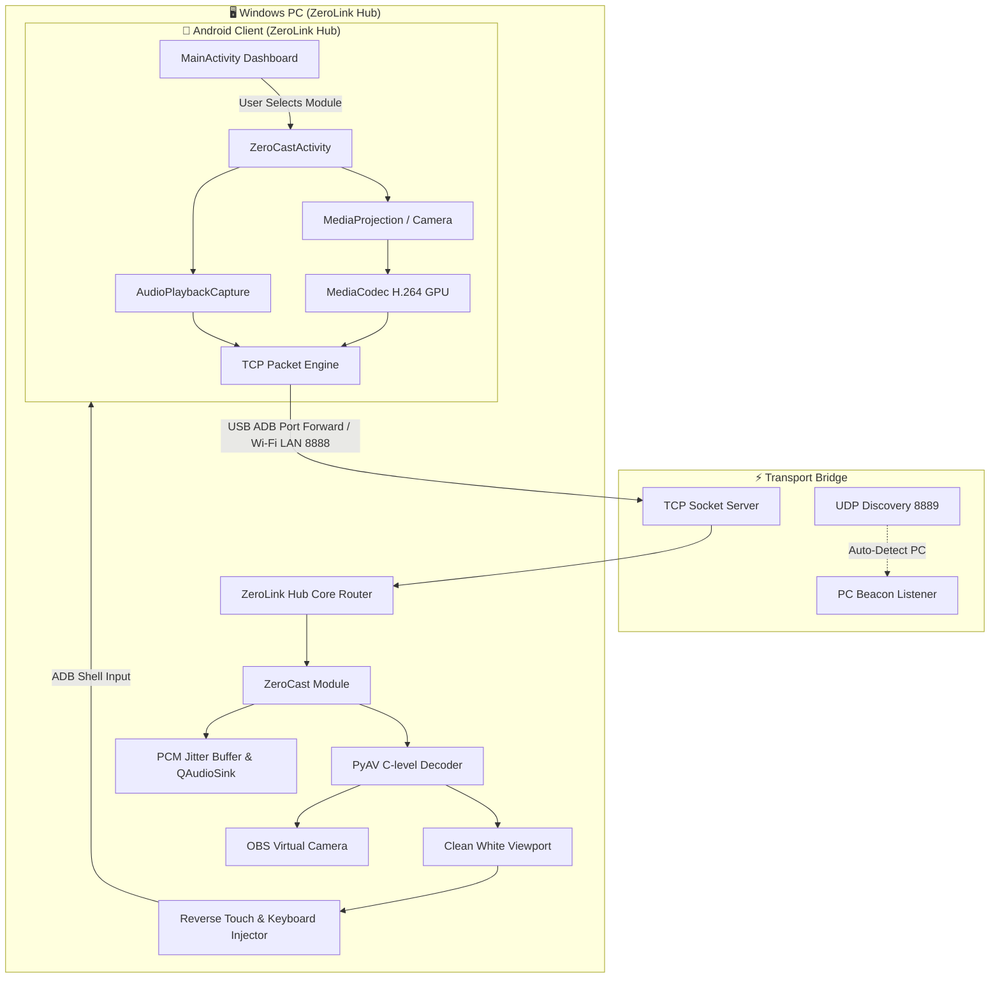

<div align="center">


# ZeroLink

### **Modular Cross-Device Ecosystem Hub • Windows PC & Android**
*Ultra-Low Latency Screen Mirroring • Studio Internal Audio • Virtual Camera • Pluggable Module Architecture*

<p align="center">
  
  
  
  
</p>

</div>

---

## 📖 Introduction

**ZeroLink** is an open-source, modular cross-device ecosystem connecting Windows PCs and Android devices. Built with a **Clean Minimalist Monochrome** aesthetic (White & Black) and a **Pluggable Architecture**, ZeroLink functions as a central command hub where features exist as independent, lightweight modules that can be toggled on demand.

If you only want basic screen casting, turn on the **ZeroCast** module. When other modules are inactive, their network sockets, audio sinks, and background listeners remain completely dormant—ensuring zero unnecessary resource usage.

---

## 🧩 The ZeroLink Module Suite

```
  ┌────────────────────────────────────────────────────────┐
  │                   ZeroLink Core Hub                    │
  │     (Device Discovery • Session Sync • Unified UI)     │
  └───────────────┬────────────────────────┬───────────────┘
                  │                        │
       ┌──────────┴──────────┐  ┌──────────┴──────────┐
       │   📺 ZeroCast        │  │   📁 ZeroDrop        │
       │   Screen / Audio     │  │   Peer LAN Transfer  │
       │   Mirroring (Active) │  │   (Roadmap v1.1)     │
       └─────────────────────┘  └─────────────────────┘
                  │                        │
       ┌──────────┴──────────┐  ┌──────────┴──────────┐
       │   📋 ZeroClip        │  │   🎮 ZeroPad         │
       │   Cross-Clipboard    │  │   Remote Touchpad    │
       │   (Roadmap v1.1)     │  │   (Roadmap v1.2)     │
       └─────────────────────┘  └─────────────────────┘
```

### 📺 1. ZeroCast *(Core Engine - Active)*
- ⚡ **Zero-Latency H.264 GPU Pipeline**: Hardware-accelerated encoding via Android `MediaCodec` into PyAV C-level decoding with baseline profile (no B-frames) for instantaneous, lag-free responsiveness.
- 🔊 **Internal Audio Capture (`AudioPlaybackCapture`)**: Streams in-game audio and system sounds in crisp 16-bit 48kHz PCM with a dynamic jitter buffer.
- 🎧 **Dynamic Audio Sink Selector**: Switch mobile audio between your Gaming Headset and PC Speakers in real-time.
- 🎥 **OBS / Discord Virtual Camera**: Convert your phone screen or mobile camera into an ultra-sharp 1080p 60FPS webcam for Discord, Zoom, Meet, and OBS Studio.
- 🖱️ **Reverse Touch & Keyboard Injection**: Click, drag, and swipe your phone directly from PC with automatic ADB tunneling; type directly using your physical computer keyboard.
- 📊 **Ghost Performance HUD**: Real-time floating performance pill on mobile (CPU, RAM, Temp) that is automatically invisible on the PC mirror.
- 🌙 **OLED Auto-Dim**: Lowers mobile display backlight to 1% while streaming to reduce heat and save battery without affecting PC mirror brightness.

### 📁 2. ZeroDrop *(Roadmap v1.1)*
- Drag-and-drop instant peer-to-peer file transfer over LAN and USB with multi-gigabit speeds.

### 📋 3. ZeroClip *(Roadmap v1.1)*
- Instant background clipboard synchronization (copy on PC → paste on Android, and vice-versa).

### 🎮 4. ZeroPad *(Roadmap v1.2)*
- Turn your smartphone into a low-latency precision PC trackpad, presentation clicker, or game controller.

---

## 🏗️ Architecture Overview



---

## 📂 Project Structure

```
ZeroLink/
├── assets/                       # Vector logos, icons, and monochrome brand assets
│   ├── logo.png                  # Primary 512x512 monochrome logo
│   └── zerolink_logo.png
├── pc_receiver/                  # 🖥️ Windows PC Application (PyQt6 / Python)
│   ├── main.py                   # Hub entry point
│   ├── icon.ico & icon.png       # PC App and window icons
│   ├── requirements.txt          # Python dependencies
│   ├── ZeroLink.spec             # PyInstaller standalone build spec
│   ├── core/                     # Modular Hub Engine
│   │   ├── base_module.py        # Abstract BaseModule interface
│   │   └── module_manager.py     # Pluggable lifecycle manager
│   ├── modules/                  # Extensible Modules Directory
│   │   └── zerocast/             # Screen & Audio streaming module
│   │       ├── cast_module.py    # ZeroCast module implementation
│   │       ├── video_receiver.py # PyAV H.264 decoder & socket server
│   │       ├── audio_receiver.py # PCM audio jitter buffer
│   │       └── virtual_camera.py # pyvirtualcam OBS integration
│   └── ui/                       # Clean Minimalist White UI
│       ├── main_window.py        # PC Hub Window with Navigation Sidebar
│       ├── dashboard_view.py     # Modular card overview with soft drop shadows
│       └── theme.py              # Minimal monochrome stylesheet
├── android_client/               # 📱 Android Application (Kotlin)
│   ├── app/src/main/
│   │   ├── AndroidManifest.xml   # Permissions, services, and launcher configs
│   │   ├── java/com/zerocast/
│   │   │   ├── ui/               # Modular UI screens
│   │   │   │   ├── MainActivity.kt      # Hub Dashboard (Modules selector)
│   │   │   │   └── ZeroCastActivity.kt  # Dedicated ZeroCast stream controller
│   │   │   ├── service/          # MediaProjection & Overlay Foreground Services
│   │   │   ├── audio/            # AudioPlaybackCapture & PCM streaming
│   │   │   ├── camera/           # CameraX manager & dual stream
│   │   │   └── util/             # UDP Discovery & Network helpers
│   │   └── res/                  # Material3 Light Clean White resources
└── dist/                         # 📦 Compiled Release Binaries
    ├── ZeroLink-v1.0.0.apk       # Android App installer
    └── ZeroLink-v1.0.0-Windows.zip # Windows PC Standalone package
```

---

## 🚀 Quick Start Guide

### Option 1: Using Pre-compiled Binaries (Recommended)
1. **Windows PC**: Download and extract `ZeroLink-v1.0.0-Windows.zip` from [`dist/`](dist/), then run **`ZeroLink.exe`**.
2. **Android**: Install `ZeroLink-v1.0.0.apk` from [`dist/`](dist/) on your phone.

---

### Option 2: Running & Building from Source

#### 1. Setup Windows PC Receiver
Requires **Python 3.10+**:
```powershell
# Navigate to PC directory
cd pc_receiver

# Install required dependencies
pip install -r requirements.txt

# Run the ZeroLink Hub
python main.py
```

To compile a standalone `.exe`:
```powershell
pyinstaller ZeroLink.spec --noconfirm
```

#### 2. Setup Android Client
Requires **Android Studio** or **Android SDK (API 34)**:
```powershell
cd android_client

# Build Debug APK
.\gradlew.bat assembleDebug

# Install directly to connected phone via ADB
adb install -r app/build/outputs/apk/debug/app-debug.apk
```

---

## 🔌 Developer Guide: Adding a New Module

ZeroLink is designed from the ground up to make adding new modules painless.

### 1. Create a PC Module (`pc_receiver/modules/<module_name>/`)
Create a class inheriting from `BaseModule`:
```python
from core.base_module import BaseModule
from PyQt6.QtWidgets import QWidget, QLabel

class MyCustomModule(BaseModule):
    @property
    def module_id(self) -> str:
        return "my_module"

    @property
    def display_name(self) -> str:
        return "My Custom Tool"

    @property
    def icon_glyph(self) -> str:
        return "⚡"

    def create_widget(self) -> QWidget:
        return QLabel("Hello from My Module!")

    def start(self) -> bool:
        # Initialize background threads, sockets, or listeners
        self._is_running = True
        return True

    def stop(self) -> bool:
        # Cleanly release ports and resources
        self._is_running = False
        return True
```
Register your module in `pc_receiver/core/module_manager.py`—it will automatically appear as an interactive card in the PC Hub and sidebar.

### 2. Create an Android Module Screen (`android_client/`)
1. Create a dedicated Activity (e.g. `MyModuleActivity.kt`).
2. Add a module card in `activity_main.xml`.
3. Set the card click listener in `MainActivity.kt` to launch your Activity.

---

## ⌨️ PC Keyboard & Mouse Shortcuts

| Action / Shortcut | Function |
| :--- | :--- |
| **Left Click & Drag** | Simulates touch tap and swipe on the Android device |
| **F11 / Double Click** | Toggle Fullscreen Mode |
| **Esc** | Exit Fullscreen / Send Android Back Key |
| **PC Typing** | Directly inputs text, letters, space, backspace, and enter to Android |
| **`🎥 V-Cam` Button** | Activates Virtual Camera feed for Discord, Zoom, OBS |
| **`📌 Pin` Button** | Pins the ZeroLink window always on top |

---

## 🌐 Creating a Brand New GitHub Repository

To push this codebase to a fresh, independent GitHub repository:

```powershell
# 1. Update the git remote to your new repository URL:
git remote set-url origin https://github.com/<your-username>/ZeroLink.git

# 2. Or create it directly with GitHub CLI (gh):
gh repo create ZeroLink --public --source=. --remote=origin --push

# 3. Push all code to main:
git branch -M main
git push -u origin main
```

---

## 📜 License

ZeroLink is open-source software licensed under the [MIT License](LICENSE).
