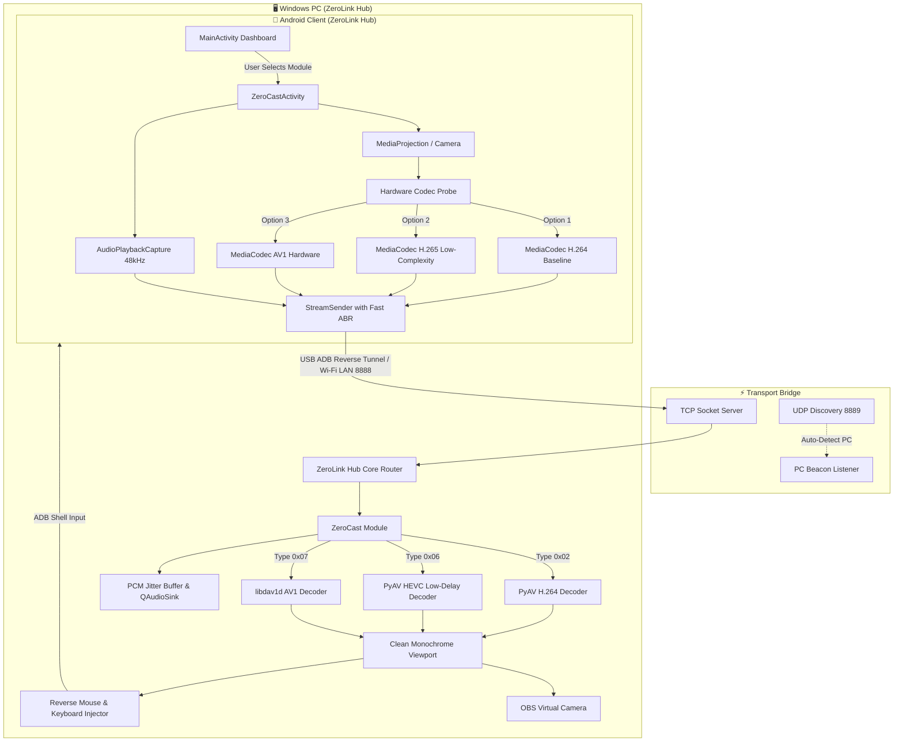

<div align="center">


# ZeroLink

### **Modular Cross-Device Ecosystem Hub • Windows PC & Android**
*Next-Gen Video Codecs (H.264 • H.265/HEVC • AV1) • Studio Internal Audio • Virtual Camera • Multi-Module Pluggable Suite*

<p align="center">
  
  
  
  
</p>

</div>

---

## 📖 Introduction

**ZeroLink** is a high-performance, modular cross-device ecosystem connecting Windows PCs and Android devices. Designed with a **Clean Minimalist Monochrome** aesthetic (Pure Black & Pure White) and an **Extensible Pluggable Architecture**, ZeroLink functions as a centralized command hub where features exist as independent, lightweight modules that can be activated on demand.

When a module is inactive, its network sockets, audio sinks, and background listeners remain completely dormant—ensuring zero unnecessary CPU/RAM overhead and absolute battery efficiency.

---

## 🧩 The ZeroLink Module Suite

```
  ┌────────────────────────────────────────────────────────┐
  │                   ZeroLink Core Hub                    │
  │     (Device Discovery • Session Sync • Connections)    │
  └───────────────┬────────────────────────┬───────────────┘
                  │                        │
       ┌──────────┴──────────┐  ┌──────────┴──────────┐
       │   📺 ZeroCast        │  │   📷 ZeroCam         │
       │   Screen & Audio     │  │   Wireless HD Webcam │
       │   (H.264/HEVC/AV1)   │  │   OBS Studio Feed    │
       └─────────────────────┘  └─────────────────────┘
                  │                        │
       ┌──────────┴──────────┐  ┌──────────┴──────────┐
       │   🖥️ ZeroDisplay     │  │   📁 ZeroDrop        │
       │   Secondary Monitor  │  │   Fast LAN File Drop │
       └─────────────────────┘  └─────────────────────┘
                  │                        │
       ┌──────────┴──────────┐  ┌──────────┴──────────┐
       │   📋 ZeroClip        │  │   🎮 ZeroPad         │
       │   Shared Clipboard   │  │   Trackpad & Macros  │
       └─────────────────────┘  └─────────────────────┘
                  │
       ┌──────────┴──────────┐
       │   🎛️ ZeroMix         │
       │   Virtual Audio & FX │
       └─────────────────────┘
```

### 📺 1. ZeroCast *(Ultra-Low Latency Screen & Audio Mirroring)*
- ⚡ **Multi-Codec Video Pipeline**:
  - **H.264 (AVC Baseline)**: Ultra-stable default fallback with zero B-frames and universal hardware compatibility.
  - **H.265 (HEVC Main Profile)**: Up to 50% bandwidth savings; deep hardware-tuned with `KEY_COMPLEXITY = 0`, Progressive Intra-Refresh, SAO bypass, and clamped QP range (18–36) for stutter-free high-motion gameplay.
  - **AV1 (AOMedia Video 1)**: Next-generation codec support with auto-probing on Android and SIMD-accelerated `libdav1d` decoding on PC.
- 🔊 **Studio Internal Audio (`AudioPlaybackCapture`)**: Streams in-game audio and system sounds in crisp 16-bit 48kHz Stereo PCM with an adaptive jitter buffer.
- 🎧 **Dynamic Audio Sink Routing**: Switch sound output instantly between Headphones, Gaming Headsets, External Monitors, and Speakers without interrupting the stream.
- 🎥 **OBS / Discord Virtual Camera**: Broadcast your screen or camera directly into `OBS Virtual Camera` for Discord, Zoom, Meet, and OBS Studio.
- 🖱️ **Reverse Touch & Keyboard Injection**: Click, drag, and swipe your phone directly from PC; type text directly using your physical PC keyboard.
- 🌙 **OLED Auto-Dim**: Lowers mobile display backlight to 1% while streaming to reduce heat and save battery without affecting PC mirror brightness.

### 📷 2. ZeroCam *(Wireless Mobile Webcam)*
- Turn your smartphone into a crystal-clear 1080p 60FPS wireless webcam.
- Supports front/rear camera toggle, torch/flash control, auto-focus lock, and direct OBS Virtual Camera streaming.

### 🖥️ 3. ZeroDisplay *(Wireless Secondary Monitor)*
- Extend your Windows desktop onto your Android tablet or phone as a genuine second monitor with zero cable clutter.

### 📁 4. ZeroDrop *(Peer-to-Peer File Transfer)*
- High-speed direct LAN/USB file and folder sharing between Windows and Android with zero cloud reliance.

### 📋 5. ZeroClip *(Shared Clipboard)*
- Instant bidirectional clipboard sync: copy text on PC → paste on Android, and vice-versa.

### 🎮 6. ZeroPad *(Remote Trackpad & Game Controller)*
- Turn your phone into a precision trackpad with multi-touch gestures, presentation remote clicker, and customizable macro keys.

### 🎛️ 7. ZeroMix *(Virtual Audio Mixer & Voice FX)*
- Route, mix, and apply real-time studio effects (pitch shifting, equalizer, noise gate) to your mobile microphone and PC audio.

---

## 🏗️ Architecture Overview



---

## 📂 Project Structure

```
ZeroLink/
├── assets/                       # Vector logos, icons, and monochrome brand assets
│   ├── logo.png                  # Primary 512x512 monochrome logo
│   └── zerolink_logo.png
├── pc_receiver/                  # 🖥️ Windows PC Application (PyQt6 / Python)
│   ├── main.py                   # Hub entry point
│   ├── icon.ico & icon.png       # PC App and window icons
│   ├── requirements.txt          # Python dependencies
│   ├── ZeroLink.spec             # PyInstaller standalone build spec
│   ├── core/                     # Modular Hub Engine
│   │   ├── base_module.py        # Abstract BaseModule interface
│   │   ├── module_manager.py     # Pluggable lifecycle manager
│   │   ├── protocol.py           # 16-Byte Binary Framing Header (H.264, HEVC, AV1)
│   │   ├── server.py             # TCP Server & Stream Dispatcher
│   │   ├── h264_decoder.py       # PyAV H.264 Zero-Latency Decoder
│   │   ├── hevc_decoder.py       # PyAV H.265 Low-Delay SIMD Decoder
│   │   ├── av1_decoder.py        # libdav1d AV1 High-Performance Decoder
│   │   ├── audio_player.py       # Studio Jitter-Buffered QAudioSink with Device Routing
│   │   ├── virtual_cam.py        # pyvirtualcam OBS integration
│   │   ├── input_controller.py   # Reverse Mouse & Keyboard ADB Injector
│   │   ├── adb_helper.py         # Automatic ADB & Port Reverse Tunneling Manager
│   │   └── discovery.py          # UDP Broadcast Beacon for LAN Auto-Discovery
│   ├── modules/                  # Extensible Modules Directory
│   │   ├── zerocast/             # Screen & Audio streaming module
│   │   ├── zerocam/              # Wireless webcam module
│   │   ├── zerodisplay/          # Secondary display module
│   │   ├── zerodrop/             # P2P LAN file drop module
│   │   ├── zeroclip/             # Shared clipboard module
│   │   ├── zeromix/              # Virtual audio mixer & Voice FX
│   │   └── zeropad/              # Trackpad & macro controller
│   └── ui/                       # Clean Minimalist Monochrome UI
│       ├── main_window.py        # PC Hub Window with Navigation Sidebar
│       ├── dashboard_view.py     # Modular card overview with clean icons
│       ├── connections_view.py   # Connection manager (USB ADB, Wi-Fi LAN, Speedtest)
│       └── theme.py              # Minimal monochrome stylesheet
├── android_client/               # 📱 Android Application (Kotlin / SDK 35)
│   ├── app/src/main/
│   │   ├── AndroidManifest.xml   # Permissions, foreground services, and activities
│   │   ├── java/com/zerocast/
│   │   │   ├── capture/
│   │   │   │   ├── ScreenCaptureH264Manager.kt  # MediaCodec H.264 Baseline Encoder
│   │   │   │   ├── ScreenCaptureHevcManager.kt  # MediaCodec H.265 Low-Complexity Encoder
│   │   │   │   ├── AudioCaptureManager.kt       # AudioPlaybackCapture 48kHz PCM
│   │   │   │   └── CameraCaptureManager.kt      # Camera2 Video Feed
│   │   │   ├── network/
│   │   │   │   ├── StreamSender.kt              # Async Socket Transmitter with Fast ABR
│   │   │   │   └── NetworkDiscovery.kt          # UDP LAN Auto-Discovery Client
│   │   │   ├── protocol/
│   │   │   │   └── PacketHeader.kt              # 16-Byte Binary Framing Header
│   │   │   ├── service/
│   │   │   │   ├── StreamForegroundService.kt   # Dynamic Rotation & MediaProjection Service
│   │   │   │   └── FloatingOverlayService.kt    # Floating Performance HUD (CPU/RAM/Temp)
│   │   │   ├── util/
│   │   │   │   └── CodecProbeHelper.kt          # MediaCodecList Hardware Capability Prober
│   │   │   └── ui/
│   │   │       ├── MainActivity.kt              # Hub Dashboard (Modules selector)
│   │   │       └── ZeroCastActivity.kt          # Dedicated ZeroCast stream controller
│   │   └── res/                  # Material3 Clean Monochrome resources
│   └── build.gradle.kts
└── dist/                         # 📦 Compiled Release Binaries
    ├── ZeroLink.apk              # Android App installer
    └── ZeroLink-Windows.zip      # Windows PC Standalone package
```

---

## 🚀 Quick Start Guide

### Option 1: Using Pre-compiled Binaries (Recommended)
1. **Windows PC**: Download and extract `ZeroLink-Windows.zip` from [`dist/`](dist/), then run **`ZeroLink.exe`**.
2. **Android**: Install `ZeroLink.apk` from [`dist/`](dist/) on your phone.
3. **Connect**:
   - **Via USB (Lowest Latency)**: Enable USB Debugging on your phone, plug it into your PC, and ZeroLink will automatically configure ADB reverse tunneling.
   - **Via Wi-Fi LAN**: Connect both devices to the same Wi-Fi network; ZeroLink will auto-discover the PC via UDP beacon.

---

### Option 2: Running & Building from Source

#### 1. Setup Windows PC Receiver
Requires **Python 3.10+**:
```powershell
# Navigate to PC directory
cd pc_receiver

# Install required dependencies
pip install -r requirements.txt

# Run the ZeroLink Hub
python main.py
```

To compile a standalone `.exe`:
```powershell
pyinstaller ZeroLink.spec --noconfirm
```

#### 2. Setup Android Client
Requires **Android Studio** or **Android SDK (API 34/35)**:
```powershell
cd android_client

# Build Debug APK
.\gradlew.bat assembleDebug

# Install directly to attached phone via ADB
adb install -r app/build/outputs/apk/debug/app-debug.apk
```

---

## ⌨️ PC Keyboard & Mouse Shortcuts

| Action / Shortcut | Function |
| :--- | :--- |
| **Left Click & Drag** | Simulates touch tap and swipe on the Android device |
| **F11 / Double Click** | Toggle Fullscreen Mode |
| **Esc** | Exit Fullscreen / Send Android Back Key |
| **PC Typing** | Directly inputs text, letters, space, backspace, and enter to Android |
| **`⛶ V-Cam` Button** | Activates Virtual Camera feed for Discord, Zoom, OBS |
| **`📌 Pin` Button** | Pins the ZeroLink window always on top |

---

## 📜 License

ZeroLink is open-source software licensed under the [MIT License](LICENSE).
